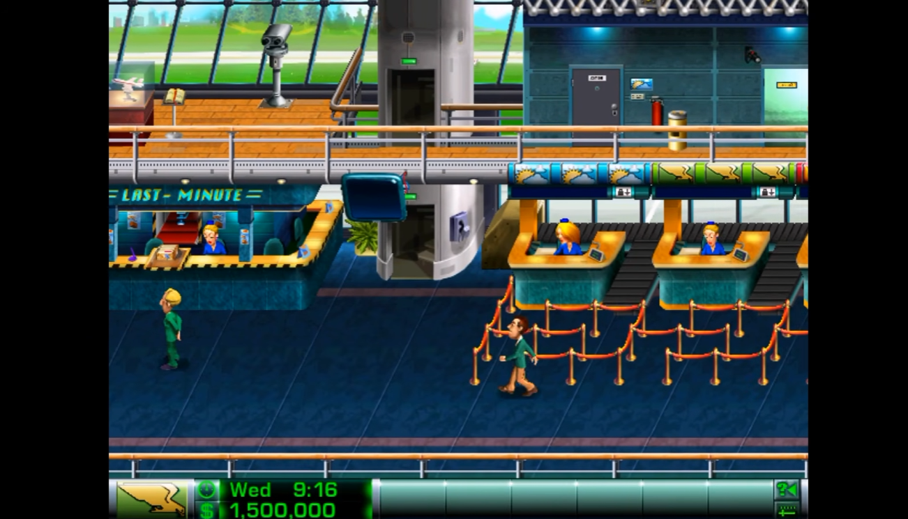
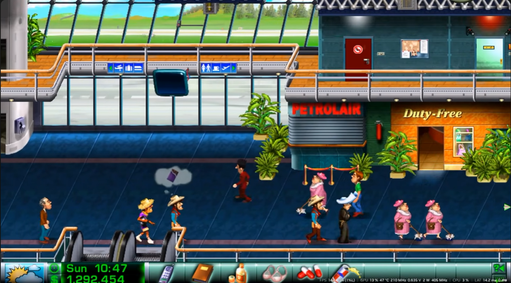

# AirlineTycoon

## Widescreen fork

Is it vibe-coded? Obviously. But it doesn't affect any of the excellent art of the game. 

This is a fork of [WizzardMaker/AirlineTycoon](https://github.com/WizzardMaker/AirlineTycoon) that adds 16:9 widescreen support.
Changes are on the `develop` branch.

| Before (4:3) | After (16:9) |
|---|---|
|  |  |

Video (click to watch on YouTube):

[](https://www.youtube.com/watch?v=5WVrUj14UTs)

- **16:9 airport view** – the airport renders at 854×480 instead of 640×480, so you see more of the terminal at once.
  The status bar stretches to the full width, and the camera stops at the edge of the original art.
- **Rooms stay 4:3** – rooms use pre-rendered 640×480 backgrounds, so they're shown centered with side bars.
  Mouse input, tooltips and the window scaling follow the active width.
- **`tools/gli/gli_tool`** – exports images from the game's `.gli` graphics libraries to PNG and imports edited
  PNGs back, for reworking art at the new width. It works on your own copy of the game files; no game art is included in this repository.
- **Design notes** – [src/Docs/Widescreen-16x9.md](src/Docs/Widescreen-16x9.md) (the conversion plan) and
  [src/Docs/Smooth-Scrolling.md](src/Docs/Smooth-Scrolling.md) (why scrolling looks choppy and how to fix it; planned, not implemented yet).

Building and running work the same as upstream (see below). You still need your own copy of the game files.

---

This repository aims to complete the partial source code that is provided as a free bonus in the GOG release
of Airline Tycoon Deluxe.

To run it you'll need the game assets from the either the First Class, Evolution or
Deluxe edition of the game. You can purchase these assets from GOG.com: https://www.gog.com/game/airline_tycoon_deluxe

## Major Additions

- Native Linux support
- Dedicated server browser and NAT-punchthrough multiplayer (open source server at: https://github.com/WizzardMaker/ATDMasterServer)

## License

The code in the repository is licensed under the terms included in the GOG release. As such the code can
only be used for non-commercial purposes and remains property of BFG.

It is therefore *not* open-source in the free software sense, for more information refer to the License.txt.

## Building and running

Before building, remember to clone the submodules:
```
git submodule update --init
```

You can see the instructions to build and run the project in [BUILDING.md](BUILDING.md).


## Credits and Contributors

- [WizzardMaker](https://github.com/WizzardMaker) - Main contributor and maintainer
- [CrossVR](https://github.com/CrossVR) - Original contributor
- [mertenpopp](https://github.com/mertenpopp) - Contributor
- [wackfx](https://github.com/wackfx) - Contributor
- [CrazyOrange](https://github.com/CrazyOrange) - Contributor
- [Heftie](https://github.com/Heftie) - Contributor
